<div align="center">



# 📄 Awesome Document Intelligence &amp; PDF Parsing OCR 🔍

<p align="center">
  <strong>Curated Directory of Intelligent Document Processing (IDP), Layout-Aware PDF-to-Markdown Converters, Multilingual Neural OCR, and LLM/RAG Ingestion Frameworks</strong>
</p>

<p align="center">
  <a href="https://github.com/ishandutta2007/Awesome-Awesome-Awesome"></a>
  <a href="https://discord.gg/jc4xtF58Ve"></a>
  <a href="https://github.com/ishandutta2007/Awesome-Document-Intelligence-PDF-Parsing-OCR/stargazers"></a>
  <a href="https://github.com/ishandutta2007/Awesome-Document-Intelligence-PDF-Parsing-OCR/network/members"></a>
  <a href="https://github.com/ishandutta2007/Awesome-Document-Intelligence-PDF-Parsing-OCR/issues"></a>
  <a href="https://github.com/ishandutta2007/Awesome-Document-Intelligence-PDF-Parsing-OCR/blob/main/LICENSE"></a>
  <a href="https://gihhub.com/ishandutta2007"></a>
</p>

---

*A high-signal, production-oriented index of both commercial **SaaS/Hosted Platforms** and top-tier **Open-Source GitHub Repositories** for document layout analysis, reading-order reconstruction, mathematical formula transcription, financial table extraction, and Vision-Language Model (VLM) parsing.*

</div>

---

## 📑 Table of Contents

- [🌐 Sector Overview &amp; Market Dynamics](#-sector-overview--market-dynamics)
- [☁️ SaaS &amp; Hosted Document Intelligence Platforms](#️-saas--hosted-document-intelligence-platforms)
- [💻 Open-Source GitHub Projects (Ranked by Stars)](#-open-source-github-projects-ranked-by-stars)
- [🛠️ Recommended Architecture &amp; RAG Frameworks](#️-recommended-architecture--rag-frameworks)
- [🤝 How to Contribute](#-how-to-contribute)
- [☕ Support &amp; Sponsor](#-support--sponsor)
- [📈 Star History](#-star-history)
- [⚖️ Disclaimer &amp; Privacy](#️-disclaimer--privacy)

---

## 🌐 Sector Overview & Market Dynamics

The global **Intelligent Document Processing (IDP)** and **Document AI** market is estimated at **$3.0B to $4.6B in 2025–2026** and is compounding aggressively at a **24% to 32% CAGR**, accelerated by the enterprise rush to feed clean unstructured PDF text into LLM Retrieval-Augmented Generation (RAG) and Agentic pipelines. The sector is **moderately fragmented** rather than a winner-take-all monopoly: hyperscalers (Microsoft Azure, AWS, Google Cloud) control foundational high-throughput OCR and multi-cloud infrastructure, traditional IDP giants (ABBYY, Rossum) capture complex enterprise financial back-offices, while agile GenAI-native startups (LlamaParse, Unstructured.io) and high-accuracy open-source models (Docling, PaddleOCR, MinerU) dominate next-generation LLM document preparation workflows.

---

## ☁️ SaaS & Hosted Document Intelligence Platforms

The table below catalogs leading commercial Document Intelligence and PDF parsing platforms. Companies are sorted in **descending order by company scale** (Market Capitalization, Private Equity Enterprise Valuation, or Latest Venture Valuation):

| Company / Platform | Company Scale (Valuation / Scale) | Core Capabilities & Architecture | Starting Paid Pricing | Free Tier / Trial Allowance |
| :--- | :--- | :--- | :--- | :--- |
| **[Microsoft Azure AI Document Intelligence](https://azure.microsoft.com/en-us/products/ai-services/ai-document-intelligence)** | **~$3.1 Trillion** (Public Market Cap) | Prebuilt neural models for invoices, receipts, tax forms, IDs, contract analysis, and layout extraction with high enterprise compliance (SOC, HIPAA, ISO). | **$1.50 per 1,000 pages** (Read OCR); **$10.00 per 1,000 pages** (Layout & Prebuilt models); **$30.00–$50.00 per 1,000 pages** (Custom neural extractors). | **500 pages free per month** (F0 Tier; max 2 pages per document, 4MB file size limit). |
| **[AWS Textract (Amazon Web Services)](https://aws.amazon.com/textract/)** | **~$2.1 Trillion** (Amazon Market Cap) | Managed multi-modal document extraction identifying raw text, handwriting, structured key-value form pairs, tables, signatures, and query-based question answering. | **$1.50 per 1,000 pages** (Detect Text); **$10.00 per 1,000 pages** (Analyze Expense); **$15.00 per 1,000 pages** (Tables); **$50.00 per 1,000 pages** (Forms & Key-Value pairs). | **3 Months Free Trial**: 1,000 pages/mo (Text Detect) and 100 pages/mo (Forms, Tables, Expense, and ID). |
| **[Google Cloud Document AI](https://cloud.google.com/document-ai)** | **~$2.1 Trillion** (Alphabet Market Cap) | Enterprise document understanding combining high-accuracy OCR, layout parsers engineered for RAG chunking, and specialized lending, procurement, and identity processors. | **$1.50 per 1,000 pages** (General OCR); **$10.00 per 1,000 pages** (Layout Parser); **$30.00 per 1,000 pages** (Form Parser & Custom Extractor). | **1,000 pages free per month** permanently for Enterprise Document OCR processor; $300 new GCP customer trial credits for specialized parsers. |
| **[Rossum](https://rossum.ai)** | **$510 Million** (Last valuation prior to Coupa acquisition; ~$22M–$45M ARR) | Cloud native, transactional IDP engine powered by proprietary Aurora AI; specialized in invoice processing, purchase orders, advanced matching, and human-in-the-loop workflows. | **$18,000 per year** (~$1,500/month Starter tier) with annual contract commitment, unlimited user seats, and API access; higher tiers custom. | **14-day free trial** with full platform interface access, automated sorting, AI learning, and document exception handling (no credit card required upfront). |
| **[Unstructured.io (Unstructured Platform)](https://unstructured.io)** | **$230 Million** (Series B valuation; ~$7.7M ARR) | Production unstructured data ETL and preprocessing platform ingesting 50+ document types into cleaned, normalized JSON elements optimized for Vector Databases. | **$0.015 per page** ($15.00 per 1,000 pages) on the standard Pay-As-You-Go platform after credits; enterprise volume discounts available. | **10,000 free pages total** provided as a one-time signup credit upon account creation (no credit card required). |
| **[Nanonets](https://nanonets.com)** | **~$150 Million–$250 Million** (Series B valuation; ~$13M–$50M ARR) | Autonomous AI document processing platform with no-code custom field extraction, automated ERP sync, validation logic, and straight-through processing. | **$100 per month** (Starter plan includes 100 workflow credits; per-block runs from $0.02 for export, $0.10 for validation, $0.30 for complex extraction). | **$50 in free platform credits** (~500 pages tested depending on workflow complexity) upon account registration (no credit card required). |
| **[ABBYY (Vantage &amp; FlexiCapture)](https://www.abbyy.com)** | **~$100 Million+** (PE-backed by Marlin Equity Partners; $45M–$1B global revenue footprint) | Decades-long enterprise industry standard for high-throughput OCR, document classification, certified compliance, on-premise deployments, and Vantage low-code AI skills. | **$0.04 to $0.08 per page** for mid-volume annual bundles (100k–500k pages/yr); drops to **$0.02 to $0.04 per page** for 1M+ pages; annual enterprise contracts start around $40,000/yr. | **60-day free trial** for ABBYY Vantage cloud evaluation environment with starter test tokens upon sales request; FlexiCapture requires guided partner PoC. |
| **[LlamaParse (LlamaIndex Cloud)](https://cloud.llamaindex.ai)** | **$93 Million** (Series A valuation; ~$10.9M ARR) | GenAI-native document parser designed specifically for LLMs and RAG; extracts complex multi-column layouts, tables, embedded charts, and math into clean Markdown and JSON. | **$1.50 per 1,000 credits** on Pay-As-You-Go overage ($0.0015/page Fast tier, $0.0045/page Cost-effective tier, $0.015/page Agentic tier); Pro plan at $500/month. | **10,000 free credits every month** recurring (translates to 10,000 pages/mo on Fast mode, 3,333 pages/mo on Cost-effective mode, or 1,000 pages/mo on Agentic mode). |
| **[Docsumo](https://www.docsumo.com)** | **~$35 Million–$50 Million** (~$10M–$12.3M ARR; venture backed by Common Ocean) | Specialized financial document intelligence extracting data from unstructured bank statements, profit/loss statements, invoices, and insurance ACORD forms with 99%+ accuracy. | Custom quote-based pricing scaling on annual document volume and pipeline complexity; typical mid-market onboarding starts at **~$500–$1,000/month**. | **14-day free trial** including up to **1,000 free pages** and 10 user licenses with pre-trained document AI models and validation APIs. |
| **[Klippa DocHorizon](https://www.klippa.com)** | **~$30 Million–$45 Million** (~$21.5M ARR; acquired by Doxis / SER Group) | Intelligent document processing platform, mobile scanning SDK, and cloud OCR API offering automated data extraction, document verification, and fraud detection. | Quote-based enterprise volume tiers scaling by document volume; standalone business apps start at €95–€275/month. | **€25 in free introductory API credits** granted upon signing up with a business email for platform testing (no credit card required). |

---

## 💻 Open-Source GitHub Projects (Ranked by Stars)

The following open-source tools and libraries power state-of-the-art document parsing, local OCR, and PDF processing. They are **sorted in descending order by GitHub Stars**, and each repository includes a badge linking directly to its stargazers:

1. **[PaddleOCR](https://github.com/PaddlePaddle/PaddleOCR)** [](https://github.com/PaddlePaddle/PaddleOCR/stargazers)  
   *Industrial-grade multilingual OCR and document layout toolkit (`PP-Structure` & `PP-OCRv4`) supporting 80+ languages, table recognition, key information extraction, and ultra-lightweight edge models.*

2. **[MinerU / Magic-PDF](https://github.com/opendatalab/MinerU)** [](https://github.com/opendatalab/MinerU/stargazers)  
   *Production-grade scientific document and textbook parsing engine that converts messy multi-column PDFs, academic formulas, and tables into clean Markdown and structured JSON.*

3. **[Tesseract OCR](https://github.com/tesseract-ocr/tesseract)** [](https://github.com/tesseract-ocr/tesseract/stargazers)  
   *The foundational open-source LSTM neural network OCR engine maintained by Google, supporting over 100 languages, hOCR output, and universally integrated into scanning pipelines.*

4. **[Docling](https://github.com/docling-project/docling)** [](https://github.com/docling-project/docling/stargazers)  
   *IBM Research-developed next-generation document conversion library parsing PDF, DOCX, PPTX, HTML, and scans into rich unified Markdown/JSON with deep layout, reading-order, and table structure models.*

5. **[Paperless-ngx](https://github.com/paperless-ngx/paperless-ngx)** [](https://github.com/paperless-ngx/paperless-ngx/stargazers)  
   *Supercharged community-supported self-hosted document management system (DMS) that organizes, automatically OCRs, tags, and full-text indexes scanned household and enterprise office documents.*

6. **[Marker](https://github.com/VikParuchuri/marker)** [](https://github.com/VikParuchuri/marker/stargazers)  
   *Ultra-fast, deep-learning powered PDF-to-Markdown/JSON converter that eliminates headers/footers, extracts tables into clean GitHub-flavored markdown, and converts math into LaTeX equations.*

7. **[OCRmyPDF](https://github.com/ocrmypdf/OCRmyPDF)** [](https://github.com/ocrmypdf/OCRmyPDF/stargazers)  
   *Indispensable command-line automation utility that injects a searchable, deskewed, lossless OCR text layer into scanned PDF files while preserving original page visual fidelity.*

8. **[EasyOCR](https://github.com/JaidedAI/EasyOCR)** [](https://github.com/JaidedAI/EasyOCR/stargazers)  
   *Ready-to-use PyTorch-based neural OCR engine supporting 80+ languages, vertical text recognition, and simple Python integration for scene text and document scanning.*

9. **[Surya](https://github.com/VikParuchuri/surya)** [](https://github.com/VikParuchuri/surya/stargazers)  
   *Modern multilingual document OCR toolkit supporting 90+ languages, line-level bounding box detection, column reading-order sorting, table recognition, and LaTeX math OCR.*

10. **[firecrawl/pdf-inspector](https://github.com/firecrawl/pdf-inspector)** [](https://github.com/firecrawl/pdf-inspector/stargazers)  
    *High-performance Rust library engineered by Firecrawl for deep PDF inspection, metadata classification, embedded stream analysis, and high-speed clean text extraction.*

11. **[olmOCR](https://github.com/allenai/olmocr)** [](https://github.com/allenai/olmocr/stargazers)  
    *Allen Institute for AI (AI2) Vision-Language Model toolkit fine-tuned specifically for linearizing complex academic PDFs, multi-column articles, and charts into LLM training datasets.*

12. **[pix2tex / LaTeX-OCR](https://github.com/lukas-blecher/LaTeX-OCR)** [](https://github.com/lukas-blecher/LaTeX-OCR/stargazers)  
    *Specialized Vision Transformer (ViT) deep-learning model designed to convert cropped images of complex mathematical equations and equations directly into LaTeX code.*

13. **[Unstructured Open Source](https://github.com/Unstructured-IO/unstructured)** [](https://github.com/Unstructured-IO/unstructured/stargazers)  
    *Widely adopted Python framework providing modular document partitioning, layout detection, table extraction, and chunking pipelines for RAG and vector database ingestion.*

14. **[PyMuPDF &amp; PyMuPDF4LLM](https://github.com/pymupdf/PyMuPDF)** [](https://github.com/pymupdf/PyMuPDF/stargazers)  
    *High-performance C/Python MuPDF bindings capable of sub-second document rendering, coordinate extraction, and native LLM-ready markdown conversion (`pymupdf4llm`).*

15. **[pdfplumber](https://github.com/jsvine/pdfplumber)** [](https://github.com/jsvine/pdfplumber/stargazers)  
    *Precision Python library for plumbing detailed character-by-character coordinates, font glyphs, bounding boxes, and extracting complex bordered/borderless tables from machine-generated PDFs.*

16. **[pypdf](https://github.com/py-pdf/pypdf)** [](https://github.com/py-pdf/pypdf/stargazers)  
    *Pure-python PDF library capable of splitting, merging, cropping, transforming, encrypting, decrypting, and extracting raw text without external system dependencies.*

17. **[Nougat](https://github.com/facebookresearch/nougat)** [](https://github.com/facebookresearch/nougat/stargazers)  
    *Meta AI Research neural optical understanding model based on Donut architecture, converting academic PDFs and technical papers directly into lightweight Markdown markup.*

18. **[Kreuzberg](https://github.com/Goldziher/kreuzberg)** [](https://github.com/Goldziher/kreuzberg/stargazers)  
    *Blazing-fast asynchronous document intelligence and text extraction engine written in Rust with Python bindings, featuring built-in OCR, image extraction, and multi-format support.*

19. **[pdfminer.six](https://github.com/pdfminer/pdfminer.six)** [](https://github.com/pdfminer/pdfminer.six/stargazers)  
    *Community-maintained Python tool for extracting textual information, exact font details, and layout hierarchies from PDF files.*

20. **[docTR](https://github.com/mindee/doctr)** [](https://github.com/mindee/doctr/stargazers)  
    *End-to-end document text recognition toolkit powered by PyTorch and TensorFlow, offering high-accuracy word/line detection, text orientation classification, and OCR.*

21. **[pytesseract](https://github.com/madmaze/pytesseract)** [](https://github.com/madmaze/pytesseract/stargazers)  
    *Standard Python wrapper for Google's Tesseract-OCR engine, enabling easy script integration, bounding box reading, and image-to-text piping.*

22. **[Camelot](https://github.com/camelot-dev/camelot)** [](https://github.com/camelot-dev/camelot/stargazers)  
    *Dedicated Python library that gives anyone complete control over extracting tabular data from PDFs using both Lattice (bordered) and Stream (whitespace-based) parsing modes.*

23. **[Kraken](https://github.com/mittagessen/kraken)** [](https://github.com/mittagessen/kraken/stargazers)  
    *Turnkey OCR and Handwritten Text Recognition (HTR) system optimized for historical documents, non-Latin scripts, and complex bidirectional manuscripts.*

---

## 🛠️ Recommended Architecture & RAG Frameworks

When designing an enterprise document ingestion pipeline for LLM RAG applications, consider this battle-tested pattern:

```
[Raw Ingestion] 
       │
       ▼
[Classification & Routing] ────► Digital Native PDF ───► PyMuPDF / pdfplumber (Fast, cheap)
       │
       ├───────────────────────► Complex Multi-column ─► Docling / Marker / MinerU (Layout-aware)
       │
       └───────────────────────► Scanned Image / Fax  ─► PaddleOCR / OCRmyPDF / Textract (OCR)
                                                                 │
                                                                 ▼
[Chunking & Vectorization] ◄── Normalized Markdown / JSON ───────┘
       │
       ▼
[Vector DB & Hybrid Search] ──► (pgvector / Qdrant / Pinecone / Milvus)
```

- **Speed & Low Cost**: Use **PyMuPDF4LLM** or **Kreuzberg** for digital-native PDFs to achieve millisecond conversion speeds.
- **Academic & Scientific Papers**: Deploy **MinerU** or **Marker** to preserve math equations, LaTeX tables, and multi-column continuity.
- **Enterprise Multi-format**: Run **Docling** (IBM) or **Unstructured** for unified handling of PDFs, DOCX, PPTX, and HTML.
- **Multilingual Scans**: Rely on **PaddleOCR** or **Surya** for zero-shot text detection across 80+ world languages.

---

## 🤝 How to Contribute

Contributions are warmly encouraged! To add or update an entry:

1. **Fork this repository** to your own GitHub profile.
2. **Edit `README.md`**:
   - For SaaS platforms: ensure you include the exact pricing structure, free tier/trial limits, and company scale.
   - For Open-Source projects: follow the star-ranking order, provide an accurate description, and include the social star badge linking to `/stargazers`.
3. **Open a Pull Request** with a concise summary of the additions or updates.

Check out [Awesome-Awesome-Awesome](https://github.com/ishandutta2007/Awesome-Awesome-Awesome) for more curated lists!

---

## ☕ Support & Sponsor

If you find this curated Document Intelligence &amp; PDF Parsing directory valuable for your research, team, or production pipelines, please consider supporting the project:

- ⭐ **Star this repository** to improve visibility and help others discover it.
- 🍴 **Fork &amp; Share** on X (Twitter), LinkedIn, Reddit, and developer communities.
- ☕ **Sponsor my open-source work**: Support continuous maintenance, updates, and benchmarks on my **[GitHub Sponsors Dashboard](https://github.com/sponsors/ishandutta2007)**!

<p align="center">
  <a href="https://github.com/sponsors/ishandutta2007">
    
  </a>
</p>

---

## 📈 Star History

[](https://www.star-history.com/#ishandutta2007/Awesome-Document-Intelligence-PDF-Parsing-OCR&type=date&legend=top-left)

---

## ⚖️ Disclaimer & Privacy

- **Community Maintained**: This repository is a community-driven catalog for research and evaluation purposes. All trademarks, company names, and logos are the property of their respective owners.
- **License Considerations**: Note software licensing when deploying in commercial settings (e.g., PyMuPDF uses AGPL-3.0 with commercial licenses from Artifex, whereas Docling uses MIT, and PaddleOCR / Tesseract use Apache-2.0).
- **PII & Data Protection**: Invoices, bank records, and legal contracts often contain confidential Personally Identifiable Information (PII). Consider deploying self-hosted open-source models (Docling, PaddleOCR, Paperless-ngx) within your private VPC for strict compliance.

---

<p align="center">
  <sub>Built with care for AI researchers, ML engineers, RAG architects, and the global open-source community.</sub>
</p>
